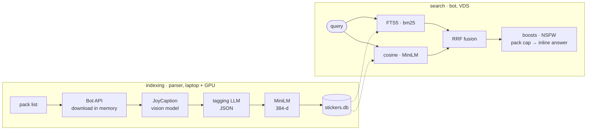

<div align="center">

# stickersbot

**Inline sticker search for Telegram — by meaning, not just keywords.**

Type `@yourbot sleepy wolf` in any chat and pick a sticker from the grid.
The index mixes full-text and multilingual embeddings, survives typos, and searches
English captions with Russian queries too.

[](https://github.com/n0rdii/stickersbot/actions/workflows/deploy.yml)


</div>


## Features

- **Inline search everywhere.** `@bot query` in any chat; nothing to add, no commands.
- **Two search channels.** SQLite FTS5 over tags and captions (bm25, porter stemming) plus
  cosine similarity over 384-d MiniLM embeddings, fused with reciprocal rank fusion.
- **Russian queries over English captions.** The dense channel is multilingual, so
  `обнимашки` and `hug` land on the same stickers.
- **Typo tolerant.** Unknown words are corrected against the index vocabulary
  (Damerau-Levenshtein) before hitting FTS.
- **Your packs first.** Favorite packs are boosted in your own results; send a sticker or a
  `t.me/addstickers/…` link and the whole pack gets queued into the index (10 packs/day).
- **Sane result list.** At most 3 stickers of one pack in the top 10, NSFW is softly demoted
  (and lifted for NSFW-intent queries), popular stickers get a small prior from real clicks.
- **Panel included.** DAU/MAU/CTR with a daily chart, description editing with re-embedding,
  user suggestions, pack requests and global boosts — one HTML file, no build step.
- **Resumable indexing.** LangGraph pipeline with a caption cache and dedup by
  `file_unique_id`: kill it any time, rerun and it continues where it stopped.

## How it works



A sticker is described by a vision model, turned into structured tags (characters, actions,
emotions, style) by a text model, and embedded. Both the caption text and the tags feed the
FTS index, so `wolf`, `gray wolf` and `crying wolf` all hit; the embedding catches `hug` vs
`обнимашки` and other paraphrases.

## Screenshots

| Inline search | Russian query |
|---|---|
|  |  |

| My packs | Sticker card |
|---|---|
|  |  |

## Search quality

Retrieval quality is measured offline with `tools/eval_search.py` on the labelled set:
hit@k (an expected pack appears among the first k distinct packs of the returned 50),
MRR, recall@k and nDCG@k — all at pack level, without personalization.

On the production snapshot (**7 495 stickers, 162 packs**), 25 queries / 99 expected packs:

| hit@10 | MRR | recall@10 | nDCG@10 |
|:------:|:---:|:---------:|:-------:|
| **1.00** | **0.60** | **0.69** | **0.53** |

The query mix is species (`fox`, `wolf`, `dragon`, …), emotions (`sad`, `hearts`), actions
(`hug`, `sleeping`, `waving`, `playing video games`), objects (`coffee`, `smartphone`,
`sunglasses`) and three Russian queries. Labels are made from the DB itself: a pack counts
as expected when at least two of its stickers really show the theme (one for very narrow
queries), so a single incidental mention never inflates the set.


## Quick start

Only the bot, against an existing `data/stickers.db`:

```bash
git clone https://github.com/n0rdii/stickersbot.git
cd stickersbot

python -m venv .venv && source .venv/bin/activate
pip install -r bot/requirements.txt

echo "BOT_TOKEN=123456:ABC..." > .env
python bot/bot.py
```

Enable **inline mode** in @BotFather (`/setinline`) and turn on inline feedback, otherwise
chosen-result events never arrive. The first start downloads the embedding model
(~470 MB) into the Hugging Face cache; `MODEL_DIR` points at a local copy instead.

## Indexing

```bash
cd parser
pip install -r ../bot/requirements.txt pillow langgraph

# .env: BOT_TOKEN, OPENROUTER_API_KEY; JOY_URL points at the JoyCaption server
python parser.py --limit 50    # trial run
python parser.py               # full run, resumable
```

Stickers are downloaded in memory, captioned (JoyCaption via an OpenAI-compatible server,
e.g. llama.cpp), tagged by a chat model (OpenRouter, or any OpenAI-compatible endpoint via
`PP_URL`), embedded and appended to `data/stickers.db`. Progress is checkpointed in
`data/raw_captions.db`. `parser/reindex.py` rebuilds derived indexes for an existing DB,
`--reembed` also recomputes vectors.

`crawler/crawler.py` harvests pack links from a Telegram channel into
`parser/base-stickerpacks.txt`. Packs requested by users land in `data/bot_data.db` and are
picked up with `--requests-db`.

## Admin panel

`PANEL_PASSWORD=... python bot/bot.py` serves a dark one-page panel on `127.0.0.1:8081`
(password → HttpOnly cookie, reachable via ssh tunnel): activity and CTR, a daily chart,
description editing with instant re-embedding + audit log, user suggestions, pack requests
and global boosts.


## Deployment

```
laptop (parser + JoyCaption)  <--dbsync-->  Google Drive  <--dbsync-->  VDS (bot, systemd)
```

`tools/dbsync.py` merges `stickers.db` three ways (new stickers from the laptop, description
edits from the panel — both survive; conflicting rows: the VDS wins), with md5 +
`PRAGMA quick_check` on every transfer and a backup before the swap. Pushing to `master`
runs the test suite and deploys over SSH. Full walkthrough: [`deploy/README.md`](deploy/README.md).

## Layout

```
parser/   indexing pipeline: graph.py (LangGraph), parser.py, embedder.py, textclean.py, prompts
bot/      the bot itself: search, metrics store, panel, private chat, texts
crawler/  pack link harvester for a Telegram channel
tools/    dbsync.py (3-way DB sync), eval_search.py (offline search quality)
deploy/   systemd units + deployment notes
evals/    labelled query set for search evals (example template in git)
tests/    unittest suite: stdlib only, fake embedder, no network, no model
data/     stickers.db, bot_data.db, raw_captions.db (runtime, not in git)
```

## Tests

```bash
python -m unittest discover -s tests
```

87 tests and no heavy dependencies: a hash-based fake embedder and a synthetic DB keep CI
fast and offline. Pre-commit runs the same suite plus formatting checks.

## Config

| Where | What |
|---|---|
| `.env` | `BOT_TOKEN`, `OPENROUTER_API_KEY`, `PANEL_PASSWORD` |
| `JOY_URL`, `JOY_MODEL` | JoyCaption endpoint / model id |
| `PP_URL`, `OPENROUTER_MODEL`, `PP_REASONING` | postprocessor endpoint / model; `PP_REASONING=off` disables reasoning (OpenRouter) |
| `AUTO_APPROVE_PACKS=1` | index user packs without a panel click |
| `EMB_DEVICE`, `MODEL_DIR` | embedder device (`cuda`/`cpu`) / local model copy |
| `dbsync.toml` | backup/sync config, see `dbsync.example.toml` |

Search knobs live in `python bot/bot.py --help`: `--top-k`, `--fts-top`, `--vec-top`
(candidate pool per channel), `--fts-weight`/`--vec-weight` (RRF weights, dense is 1.5 by
default), `--max-per-pack`, `--diverse-top`, `--nsfw-penalty`, `--pop-weight`.
