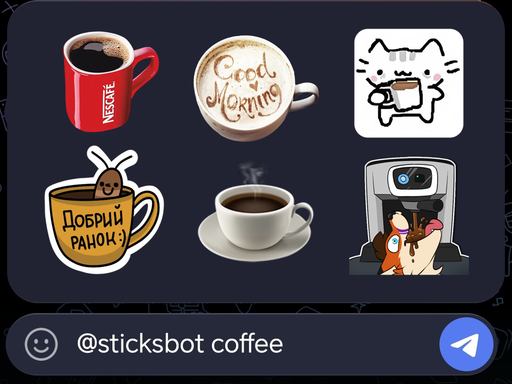
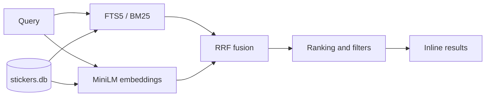

<div align="center">

# stickersbot

Inline sticker search for Telegram.

Search by meaning, not just keywords: multilingual queries, typo tolerance, two retrieval channels.



[](https://github.com/n0rdii/stickersbot/actions/workflows/deploy.yml)


</div>

Type `@yourbot coffee` in any Telegram chat and choose a sticker from the results.

## Quick start

The bot reads its search index from `data/stickers.db`. Put an existing database there,
or build one first — see [Indexing](#indexing). Then:

```bash
python -m venv .venv
source .venv/bin/activate

pip install -r bot/requirements.txt

echo "BOT_TOKEN=123456:ABC..." > .env
python bot/bot.py
```

Enable **Inline Mode** for your bot in [@BotFather](https://t.me/BotFather) with
`/setinline`, and turn on inline feedback: chosen-result updates feed the click stats.
On the first start the embedding model (~470 MB) is downloaded into the Hugging Face
cache; set `MODEL_DIR` to use a local copy instead.

## What it does

- **Inline search:** `@bot query` in any chat, nothing to add.
- **Hybrid retrieval:** SQLite FTS5 (BM25) and MiniLM embeddings, fused with reciprocal rank fusion.
- **Multilingual search:** a Russian query finds stickers with English captions.
- **Typo correction:** unknown words are checked against the index vocabulary before the full-text search.
- **Pack preferences:** stickers from your favorite packs get a ranking boost. Send a sticker or a `t.me/addstickers/...` link to queue its pack for indexing (up to 10 packs per day).
- **Result diversity:** no more than 3 stickers from one pack in the top 10.
- **NSFW handling:** such stickers are demoted unless the query itself looks NSFW.
- **Admin panel:** activity metrics, CTR, description editing, suggestions, pack requests and global boosts.
- **Resumable indexing:** the LangGraph pipeline caches captions and deduplicates stickers by `file_unique_id`.

## How search works



During indexing, each sticker is processed by a vision model (JoyCaption). A text model
turns the caption into structured tags — characters, actions, emotions, style — and MiniLM
generates a 384-dimensional embedding. Both the caption and the tags feed the search index:

- FTS5 handles exact terms and related word forms;
- embeddings help with paraphrases and queries in other languages;
- reciprocal rank fusion combines both lists before the ranking adjustments.

## Search quality

Search quality is evaluated offline with `tools/eval_search.py`. The evaluation uses
labelled queries and measures hit@k, MRR, recall@k and nDCG@k at pack level, without
personalization.

Production snapshot: **7 495 stickers, 162 packs**. Evaluation set: 25 queries, 99 expected packs.

| hit@10 | MRR | recall@10 | nDCG@10 |
|:---:|:---:|:---:|:---:|
| **1.00** | **0.60** | **0.69** | **0.53** |

The set covers actions, emotions, objects and Russian-language queries. Labels are made
from the database: a pack counts as relevant when several of its stickers really show the
theme — 15–30 for broad character queries, 2 for most themes, 1 for very narrow ones.

```bash
cp evals/queries.example.jsonl evals/queries.jsonl   # then fill in your own pack names
python tools/eval_search.py --db data/stickers.db -k 10
```

Labels are JSONL, `#` lines are comments: `{"query": "morning coffee", "packs": ["coffee_mugs"]}`.

## Indexing

The pipeline lives in `parser/`. It downloads stickers in memory, captions them with
JoyCaption, creates structured tags with a chat model, computes embeddings and appends
everything to `data/stickers.db`. Environment variables are listed in
[Configuration](#configuration); the parser needs `BOT_TOKEN`, `OPENROUTER_API_KEY` and a
running `JOY_URL`.

```bash
cd parser
pip install -r ../bot/requirements.txt pillow langgraph

python parser.py --limit 50    # small batch first
python parser.py               # full pack list
```

Indexing is resumable: progress is stored in `data/raw_captions.db`, so you can stop the
process and run it again later.

Other indexing tools:

- `parser/reindex.py` rebuilds derived indexes for an existing database; `--reembed` also recomputes vectors.
- `crawler/crawler.py` collects pack links from a Telegram channel into `parser/base-stickerpacks.txt`.
- Packs requested by users are stored in `data/bot_data.db` and can be processed with `--requests-db`.

## Admin panel

Set `PANEL_PASSWORD` before starting the bot:

```bash
PANEL_PASSWORD=your-password python bot/bot.py
```

The panel is served on `127.0.0.1:8081`: DAU, MAU and CTR with a daily chart, description
editing with re-embedding and an audit log, user suggestions, pack requests and global
ranking boosts. Auth is a password into an HttpOnly cookie; for remote access use an SSH
tunnel rather than exposing the port.

## Deployment

```text
PC with GPU (parser + JoyCaption)  <-- dbsync -->  Google Drive  <-- dbsync -->  VDS (bot, systemd)
```

`tools/dbsync.py` performs a three-way merge of `stickers.db`: new stickers from the PC with GPU
and description edits made in the panel both survive, and when the same row conflicts the
VDS version wins. Transfers are checked with MD5 and `PRAGMA quick_check`, and the previous
database is kept as a backup before the swap.

Pushing to `master` runs the test suite and deploys over SSH. Full walkthrough:
[`deploy/README.md`](deploy/README.md).

## Configuration

| Variable / file | Description |
|---|---|
| `.env` | `BOT_TOKEN`, `OPENROUTER_API_KEY`, `PANEL_PASSWORD` |
| `JOY_URL`, `JOY_MODEL` | JoyCaption endpoint and model |
| `PP_URL`, `OPENROUTER_MODEL`, `PP_REASONING` | postprocessor endpoint, model and reasoning setting (`PP_REASONING=off` disables reasoning) |
| `AUTO_APPROVE_PACKS=1` | index user-submitted packs without panel approval |
| `EMB_DEVICE` | embedding device: `cuda` or `cpu` |
| `MODEL_DIR` | path to a local embedding model |
| `dbsync.toml` | database sync settings; see `dbsync.example.toml` |

Search ranking options: `python bot/bot.py --help`. That covers the answer size
(`--top-k`, at most 50), candidate pools per channel (`--fts-top`, `--vec-top`), RRF
weights (`--fts-weight`, `--vec-weight`; the dense channel is 1.5 by default), pack
diversity (`--max-per-pack`, `--diverse-top`) and ranking adjustments (`--nsfw-penalty`,
`--pop-weight`).

## Tests

```bash
python -m unittest discover -s tests
```

87 tests on a fake embedder and a synthetic database: no model download, no network.
The same suite runs in CI and in pre-commit (`uv tool run pre-commit run --all-files`).

## Project layout

```text
parser/   indexing pipeline, prompts and embedding code
bot/      Telegram bot, search, metrics, admin panel and user flows
crawler/  Telegram channel pack-link collector
tools/    database sync and search evaluation
deploy/   systemd units and deployment instructions
evals/    labelled search evaluation set
tests/    offline unittest suite
data/     runtime databases (not tracked in git)
```
